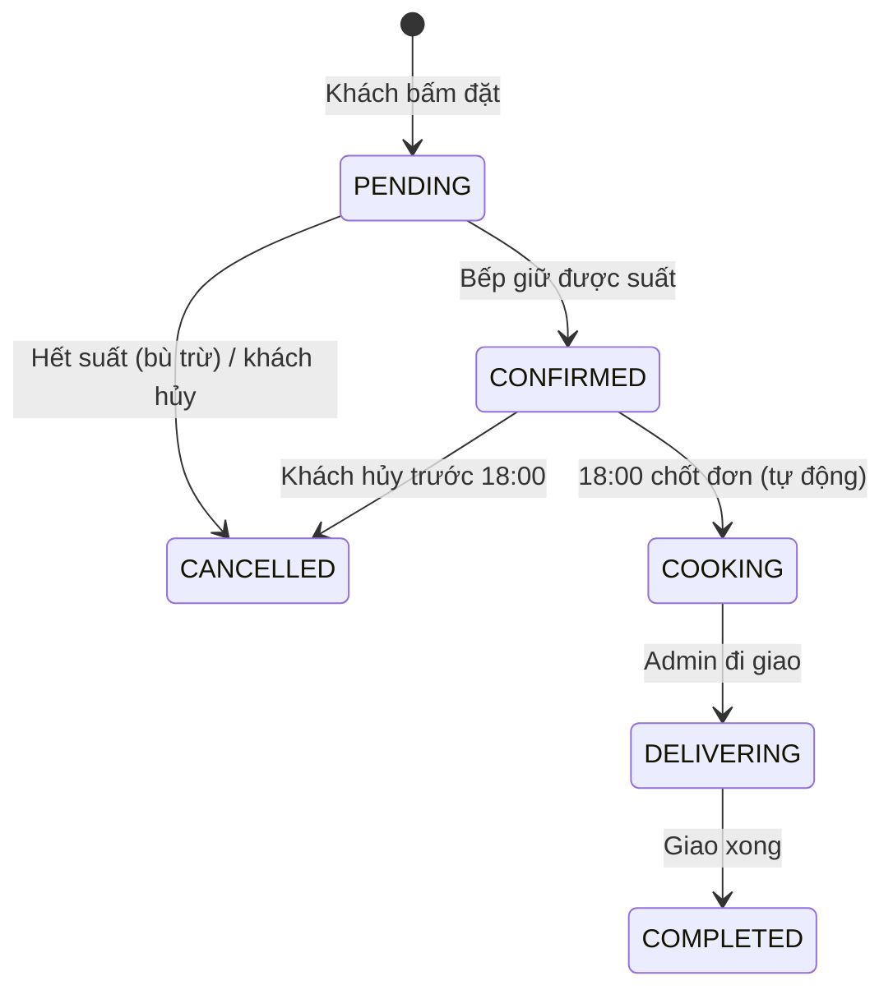
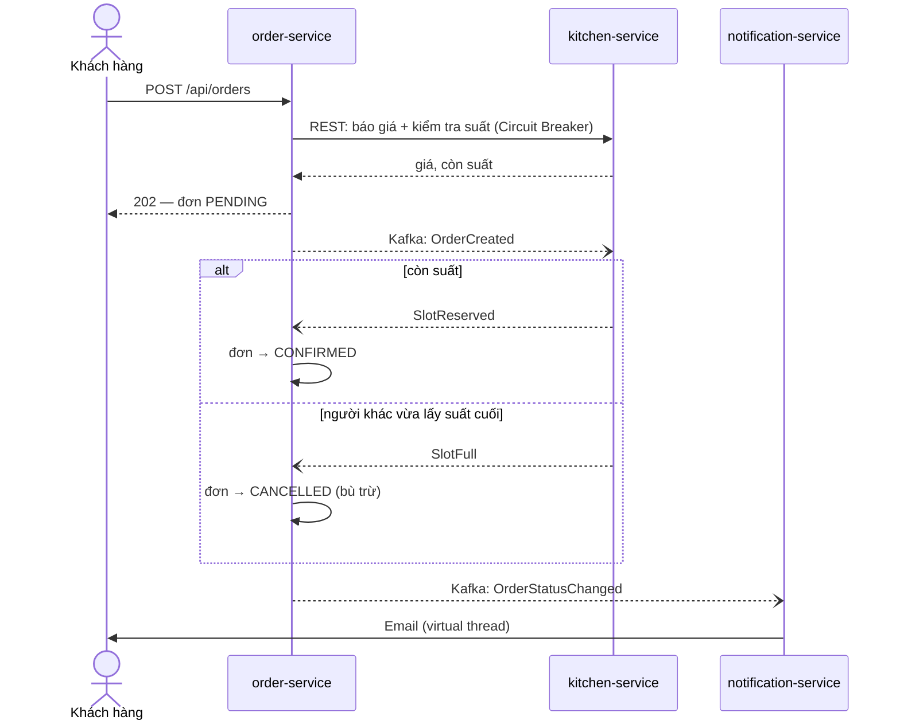
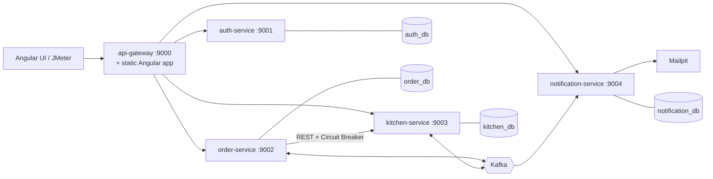
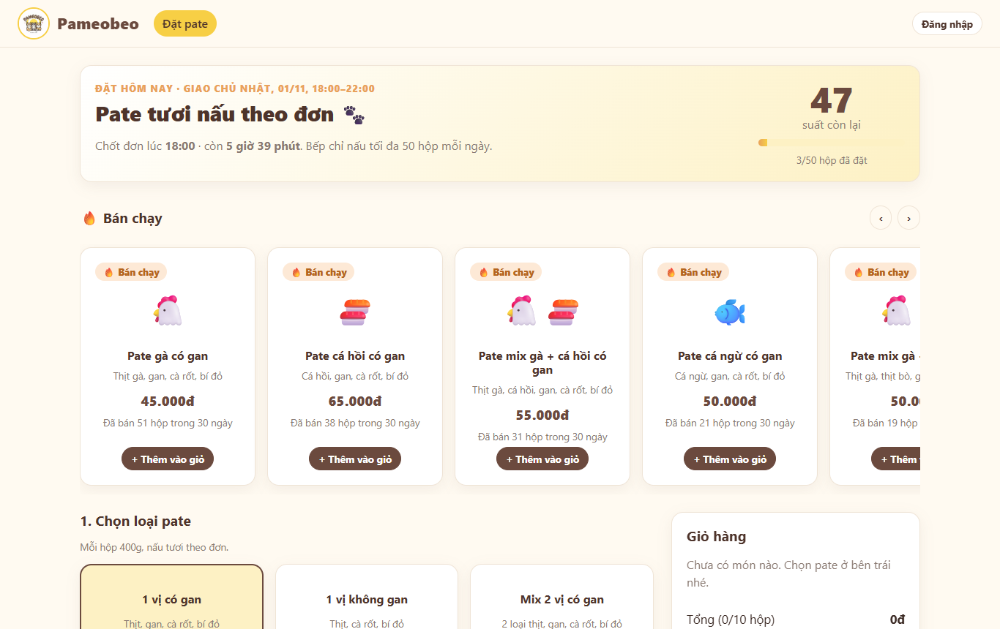
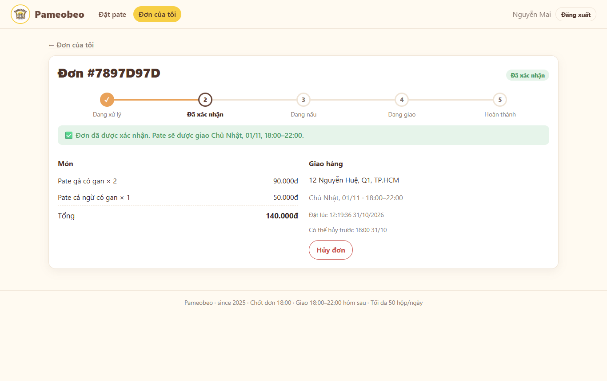
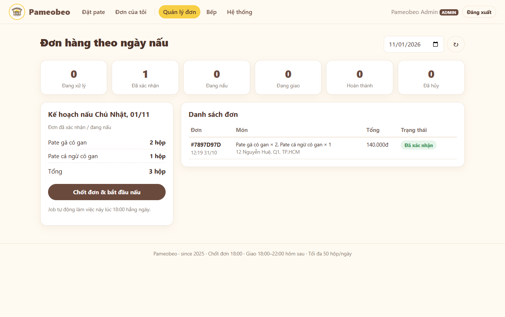
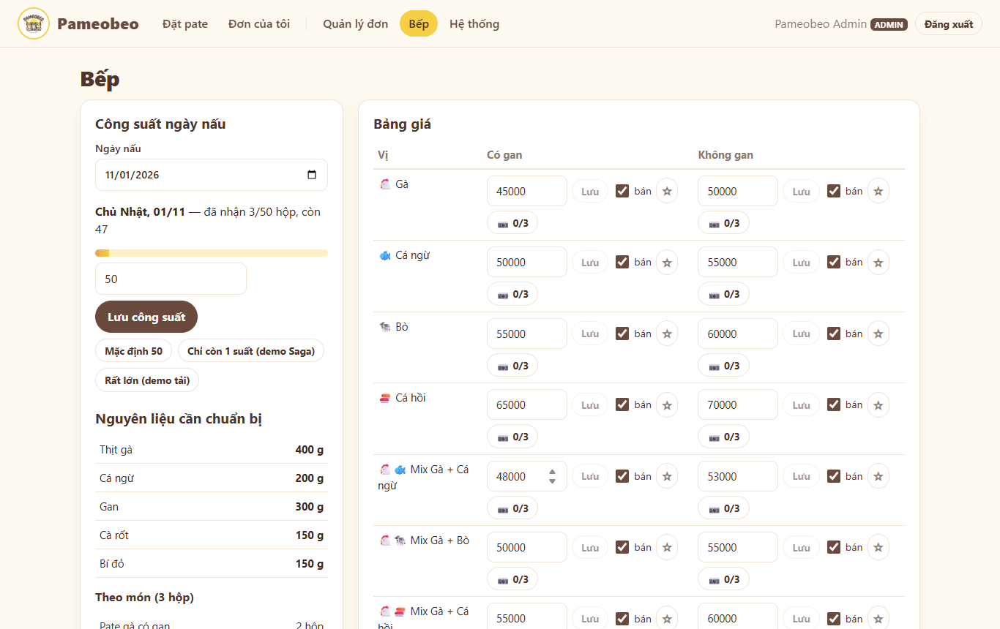
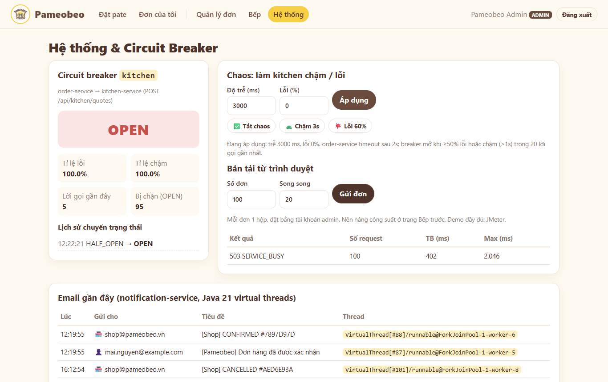
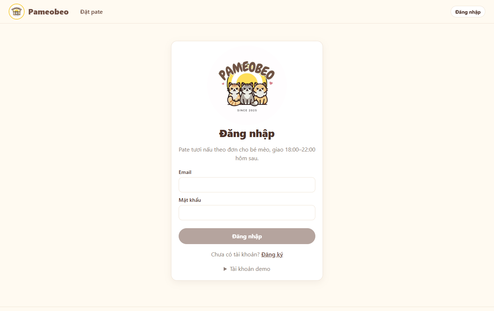

# Pameobeo — Pate tươi cho mèo (Microservices)

Hệ thống đặt pate tươi cho mèo theo mô hình **làm theo đơn**: đặt trước 18:00, bếp chuẩn bị và nấu, giao **18:00–22:00 hôm sau**, tối đa **50 hộp mỗi ngày nấu**. Nghiệp vụ lấy từ cửa hàng pate tác giả từng tự vận hành.

**Tech:** Angular 22 · Java 21 · Spring Boot 3.5 · Spring Cloud Gateway (WebFlux) · Spring Security / OAuth2 Resource Server · Spring Data JPA · Flyway · PostgreSQL · Kafka (KRaft) · Resilience4j · JUnit 5 · ArchUnit · JMeter

---

## Nghiệp vụ

### Bài toán

Một tiệm nhỏ bán **pate tươi tự nấu cho mèo**. Pate không làm sẵn: tiệm gom đơn trong ngày, tối đó đi chợ và nấu, hôm sau giao. Vì bếp chỉ có một người nên **mỗi ngày nấu tối đa 50 hộp**. Hệ thống phải:

- cho khách xem menu, số suất còn lại và đặt hàng online;
- **không bao giờ nhận quá 50 hộp** một ngày, kể cả khi nhiều người cùng tranh suất cuối;
- tự chốt đơn lúc 18:00 và báo cho admin cần chuẩn bị bao nhiêu nguyên liệu;
- gửi email cho khách mỗi khi đơn đổi trạng thái.

### Người dùng

| Vai trò | Làm được gì |
|---|---|
| **Khách vãng lai** | Xem menu, món bán chạy, số suất còn lại; đăng ký / đăng nhập |
| **Khách hàng** (`CUSTOMER`) | Đặt hàng, xem đơn của mình, hủy đơn trước giờ chốt |
| **Chủ tiệm** (`ADMIN`) | Quản lý menu, giá, ảnh; chỉnh công suất từng ngày; xem nguyên liệu cần mua; chuyển đơn sang đang giao / hoàn tất |
| **Hệ thống** | Chốt đơn lúc 18:00, giữ / trả suất, gửi email |

### Mốc thời gian một đơn hàng

```
          Ngày D                               Ngày D+1
──────────────────────────────┬──────────────────────────────┬──────────────►
   khách đặt hàng             │  đi chợ + nấu + đóng hộp     │ 18:00–22:00
                       18:00  │                              │ giao hàng
                    chốt đơn  │                              │
```

- Đặt **trước 18:00 ngày D** thì nhận hàng **18:00–22:00 ngày D+1**. Đặt sau 18:00 thì đơn chuyển sang ngày nấu kế tiếp (D+2), và khách phải đồng ý trước.
- Chỉ được hủy **trước 18:00 ngày D**. Hủy thì suất được trả lại cho ngày nấu đó.

### Sản phẩm

- Có 4 vị: **gà, cá ngừ, bò, cá hồi**. Mỗi hộp 400g, chia thành 4 loại: 1 vị có gan, 1 vị không gan, mix 2 vị có gan, mix 2 vị không gan. Tổng cộng **20 món**, mỗi món có giá riêng.
- Admin bật / tắt món, đổi giá và tải ảnh lên (tối đa 3 ảnh mỗi món).
- Từ công thức của từng món, hệ thống tính ra **số gram nguyên liệu cần mua** cho một ngày nấu.

### Luật nghiệp vụ chính

| # | Luật |
|---|---|
| 1 | Mỗi ngày nấu tối đa **50 hộp**, tính chung cho mọi món. Admin chỉnh được theo ngày, nhưng không được đặt thấp hơn số hộp đã nhận |
| 2 | Mỗi đơn từ **1 đến 10 hộp**. Còn ít suất hơn số khách muốn đặt thì **từ chối cả đơn**, không tự cắt bớt |
| 3 | Giờ chốt tính theo **lúc khách bấm đặt**, không theo lúc bếp xử lý |
| 4 | Thêm vào giỏ hàng **không giữ suất**. Suất chỉ bị trừ khi bếp xác nhận đơn |
| 5 | **Giá được chụp lại lúc đặt**. Admin đổi giá sau đó không ảnh hưởng đơn cũ |
| 6 | Bấm đặt 2 lần (do mạng chậm hoặc bấm đúp) chỉ tạo **1 đơn** |
| 7 | Bếp quá chậm hoặc không phản hồi thì báo ngay *"Hệ thống đang bận"*, không bắt khách chờ |
| 8 | Sai mật khẩu 5 lần liên tiếp thì khóa đăng nhập 15 phút |

### Vòng đời đơn hàng



Mỗi lần đơn sang `CONFIRMED`, `CANCELLED`, `DELIVERING` hoặc `COMPLETED`, khách nhận một email.

### Luồng đặt hàng qua các service



Đơn được tạo ở `order_db`, còn suất nằm ở `kitchen_db`, nên không thể dùng một transaction chung cho cả hai. Hệ thống dùng **Saga**: bếp giữ suất ở bước sau; nếu không giữ được thì đơn bị hủy để bù trừ. Vì vậy API trả `202` và đơn đi qua trạng thái `PENDING` trước khi được xác nhận.

### Từ vấn đề nghiệp vụ tới kỹ thuật

| Vấn đề nghiệp vụ | Cách giải quyết |
|---|---|
| Hai khách cùng tranh suất cuối, không được nhận quá 50 hộp | Optimistic locking trên aggregate `CookingDay` |
| Đơn và suất nằm ở 2 database khác nhau | Saga choreography + bù trừ |
| Lưu đơn và gửi event phải cùng thành công hoặc cùng thất bại | Transactional Outbox |
| Bấm đặt 2 lần, hoặc Kafka giao lại message | Idempotency-Key + Idempotent Consumer |
| Bếp chậm không được kéo sập chức năng đặt hàng | Circuit Breaker + timeout + fallback 503 |
| Gửi email chậm không được làm chậm việc đặt hàng | Kafka + Java 21 virtual threads |
| Đơn không được đổi trạng thái sai thứ tự | State machine trong aggregate `Order` |

Đặc tả đầy đủ (luồng lỗi, tiêu chí chấp nhận): [docs/use-cases.md](docs/use-cases.md)

---

## Kiến trúc



| Service | Trách nhiệm |
|---|---|
| **frontend** (Angular 22) | Giao diện khách hàng (đặt pate, theo dõi đơn) và admin (quản lý đơn, bếp, bảng điều khiển Circuit Breaker). Bản build được đóng gói vào gateway |
| **api-gateway** | Cửa vào duy nhất, kiểm tra JWT (401/403), định tuyến, `X-Correlation-Id`, phục vụ giao diện Angular. Chạy trên WebFlux (non-blocking) |
| **auth-service** | Đăng ký / đăng nhập, JWT **RS256** + **JWKS**, refresh token (rotation, idle 30 phút, tối đa 7 ngày), khóa 15 phút sau 5 lần sai |
| **order-service** | Đơn hàng + state machine, **Saga** (choreography) + **Outbox**, gọi kitchen qua REST có **Circuit Breaker**, job chốt đơn 18:00 |
| **kitchen-service** | Menu, ngày nấu, công suất 50 hộp (**optimistic locking**), giữ / trả suất, endpoint chaos để demo |
| **notification-service** | Nghe `OrderStatusChanged`, gửi email song song trên **Java 21 virtual threads** |

Chi tiết: [docs/architecture.md](docs/architecture.md) · Events: [docs/events.md](docs/events.md) · Use cases: [docs/use-cases.md](docs/use-cases.md) · Quyết định thiết kế: [docs/adr/](docs/adr/)


## Giao diện

**Khách hàng**

| Đặt pate: số suất còn lại, món bán chạy, giỏ hàng | Đơn được Saga xác nhận (`PENDING` → `CONFIRMED`) |
|---|---|
|  |  |

**Chủ tiệm (admin)**

| Quản lý đơn theo ngày nấu, kế hoạch nấu, chốt đơn | Bếp: công suất, nguyên liệu cần chuẩn bị, bảng giá |
|---|---|
|  |  |

| Hệ thống: kitchen bị làm chậm 3s → Circuit Breaker **OPEN**, 95/100 request bị chặn ngay | Đăng nhập (JWT từ auth-service) |
|---|---|
|  |  |

---

## Đối chiếu tiêu chí đề bài

| Tiêu chí | Áp dụng | Kiểm chứng |
|---|---|---|
| Service xử lý security cho các microservice (Spring Security) | **auth-service** cấp JWT RS256 + JWKS; **gateway** và **mọi service** là OAuth2 Resource Server (kiểm tra 2 lớp) | `scripts/demo.sh security` → 401 / 200 / 403 |
| ≥ 2 microservice giao tiếp với nhau | order → kitchen qua **REST**; order ↔ kitchen ↔ notification qua **Kafka** | `scripts/demo.sh order`, Kafka UI |
| ≥ 1 pattern CQRS / Event Sourcing / Saga | **Saga choreography**: `OrderCreated` → `SlotReserved` / `SlotFull` → `CONFIRMED` / `CANCELLED` (bù trừ), kèm **Transactional Outbox** và **Idempotent Consumer** | `scripts/demo.sh saga` |
| Circuit Breaker cho API giữa các service | Resilience4j trên `KitchenRestClient` (order → kitchen), timeout ở HTTP client, fallback 503 | `scripts/cb-demo.sh`, JMeter |
| Clean Architecture + DDD | `domain` / `application (ports)` / `infrastructure` / `interfaces`; aggregate `Order`, `CookingDay`, `User`; kiểm tra bằng **ArchUnit** | `mvn verify` |
| ≥ 1 service xử lý bất đồng bộ (WebFlux / Java 21) | **notification-service**: Kafka + virtual threads; **api-gateway**: WebFlux | `scripts/demo.sh async` → `VirtualThread[#..]` |
| Demo Circuit Breaker bằng JMeter, tái hiện quá tải | `jmeter/circuit-breaker-demo.jmx`: chaos switch, theo dõi breaker; có thêm kịch bản quá tải thật (5 thread). Trang **Hệ thống** trên web hiện trạng thái breaker theo thời gian thực | [docs/circuit-breaker-demo.md](docs/circuit-breaker-demo.md) |

---

## Chạy dự án

**Cần:** JDK 21+, Maven 3.9+, Docker (Docker Desktop hoặc Colima). Muốn demo bằng JMeter thì cần thêm JMeter 5.6+.

```bash
# 1. Hạ tầng: PostgreSQL (4 database), Kafka, Kafka UI, Mailpit
docker compose up -d

# 2. Build + chạy 5 service (log ở .run/<service>.log)
scripts/start-all.sh

# 3. Mở giao diện: http://localhost:9000  (admin@pameobeo.vn / Admin@123)
#    hoặc chạy toàn bộ kịch bản demo bằng terminal:
scripts/demo.sh

# 4. Demo Circuit Breaker
scripts/cb-demo.sh                      # không cần JMeter
jmeter -t jmeter/circuit-breaker-demo.jmx   # JMeter GUI

# Dừng
scripts/stop-all.sh
docker compose down
```

| Địa chỉ | |
|---|---|
| **http://localhost:9000** | **Giao diện web** + API gateway (mọi request đi qua đây) |
| http://localhost:8090 | Kafka UI (xem event) |
| http://localhost:8025 | Mailpit (xem email) |
| http://localhost:9002/actuator/circuitbreakers | Trạng thái Circuit Breaker |
| http://localhost:900{1,2,3}/swagger-ui.html | Swagger UI của auth / order / kitchen |

Tài khoản admin có sẵn: `admin@pameobeo.vn` / `Admin@123`.

Port đã được chọn để tránh trùng với các container hay dùng: PostgreSQL ở **5440**, các service ở **9000–9004**.

### Test

```bash
mvn verify      # unit test domain + use case (dùng fake) + ArchUnit, không cần Docker
```

---

## API chính (qua gateway)

| Method | Path | Quyền | Mô tả |
|---|---|---|---|
| POST | `/api/auth/register` | public | Đăng ký (luôn là CUSTOMER) |
| POST | `/api/auth/login` | public | Nhận access token (15 phút) + refresh token |
| POST | `/api/auth/refresh` | public | Đổi refresh token lấy cặp token mới (rotation) |
| POST | `/api/auth/logout` | public | Thu hồi refresh token |
| GET | `/api/kitchen/menu` | public | Menu đang bán |
| GET | `/api/kitchen/menu/highlights` | public | Tối đa 5 món bán chạy (30 ngày), bù bằng "Gợi ý của tiệm" |
| GET | `/api/kitchen/menu/{id}/images/{imageId}` | public | Ảnh sản phẩm (cache lâu dài, id ảnh không bao giờ dùng lại) |
| GET | `/api/kitchen/availability?date=` | public | Công suất / số suất còn lại của ngày nấu |
| POST | `/api/orders` | CUSTOMER | Đặt hàng → `202` + `PENDING` (header `Idempotency-Key` tùy chọn) |
| GET | `/api/orders`, `/api/orders/{id}` | CUSTOMER | Đơn của tôi |
| POST | `/api/orders/{id}/cancel` | CUSTOMER | Hủy trước 18:00 ngày D |
| GET | `/api/orders/admin?cookingDate=` | ADMIN | Tất cả đơn |
| POST | `/api/orders/admin/cooking-days/{date}/start-cooking` | ADMIN | Chốt đơn bằng tay (như job 18:00) |
| PATCH | `/api/orders/admin/{id}/status` | ADMIN | `DELIVERING` / `COMPLETED` |
| PUT | `/api/kitchen/admin/cooking-days/{date}/capacity` | ADMIN | Đổi công suất |
| PATCH | `/api/kitchen/admin/menu/{id}` | ADMIN | Đổi giá / bật tắt món / chọn "Gợi ý của tiệm" (`featured`) |
| POST | `/api/kitchen/admin/menu/{id}/images` | ADMIN | Tải ảnh lên (multipart `file`, tối đa 3 ảnh, 2 MB, JPG/PNG/WebP) |
| PUT | `/api/kitchen/admin/menu/{id}/images/{imageId}/cover` | ADMIN | Đặt làm ảnh bìa |
| DELETE | `/api/kitchen/admin/menu/{id}/images/{imageId}` | ADMIN | Xóa ảnh |
| GET | `/api/kitchen/admin/cooking-days/{date}/plan` | ADMIN | Nguyên liệu cần chuẩn bị + số hộp theo món của ngày nấu |
| PUT | `/api/kitchen/admin/chaos` | ADMIN | Bật độ trễ / lỗi giả cho `/quotes` (demo CB) |
| GET | `/api/notifications/admin/recent` | ADMIN | Email đã gửi + thread đã gửi |

Ví dụ đặt hàng:
```bash
curl -X POST localhost:9000/api/orders \
  -H "Authorization: Bearer $TOKEN" -H "Content-Type: application/json" \
  -H "Idempotency-Key: $(uuidgen)" \
  -d '{"items":[{"menuItemId":"11111111-1111-1111-1111-111111111111","quantity":2}],
       "deliveryAddress":"12 Nguyen Hue, Q1","confirmNextCookingDay":false}'
```

---

## Cấu trúc repo

```
pameobeo/
├── frontend/                   Angular 22 (xem frontend/README.md)
├── api-gateway/  auth-service/  order-service/  kitchen-service/  notification-service/
│     └── src/main/java/com/pameobeo/<service>/{domain, application, infrastructure, interfaces}
├── docker-compose.yml          hạ tầng
├── infra/postgres/             script tạo 4 database
├── scripts/                    start-all, stop-all, demo, cb-demo
├── jmeter/                     test plan Circuit Breaker + script chạy CLI
└── docs/                       use cases, architecture, events, ADR, demo CB, hướng dẫn thuyết trình
```

---

## Ghi chú thiết kế

- **Vì sao 202 mà không phải 201?** Đơn được xác nhận bất đồng bộ (Saga). Client hỏi `GET /api/orders/{id}` hoặc nhận email.
- **Quy mô thật** (50 hộp/ngày, 1 người vận hành) thì **monolith là đủ**. Microservice ở đây để học, kèm hiểu rõ cái giá: Saga, outbox, idempotency, eventual consistency.
- Ngoài phạm vi bài tập (để sau): thanh toán VNPay, Redis (rate limit, blacklist JWT), CQRS read model, Kubernetes, Prometheus/Grafana.
