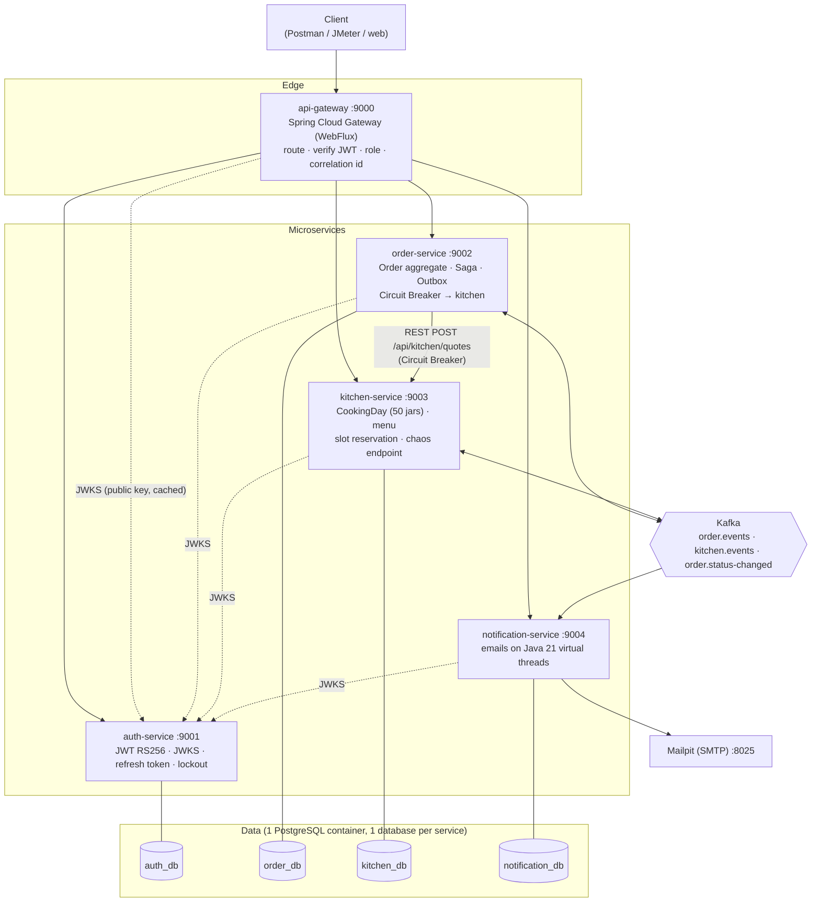
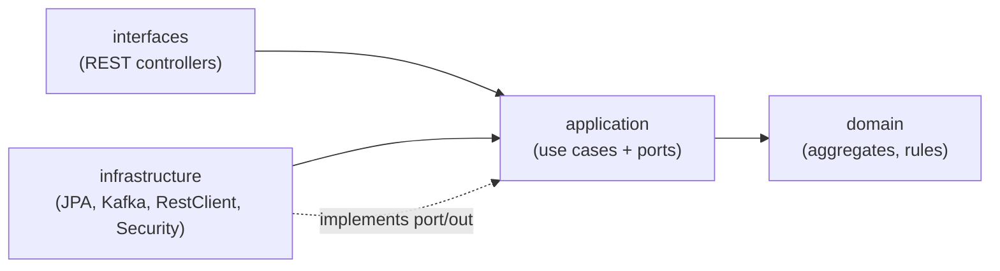
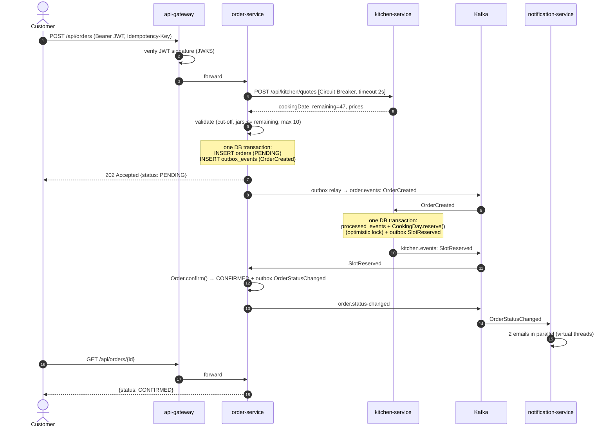
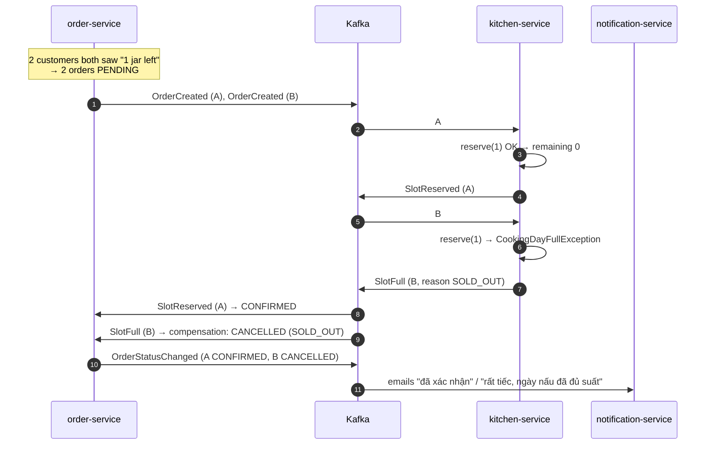
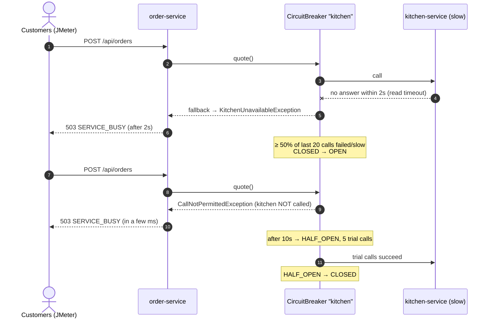
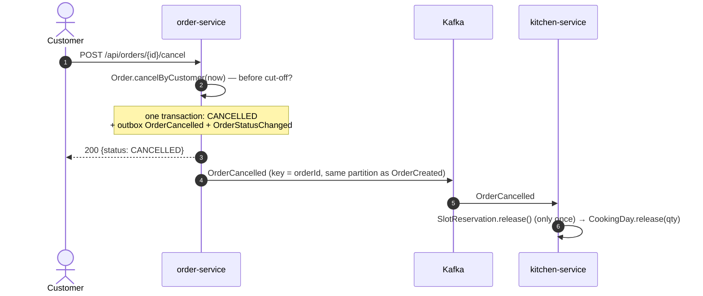
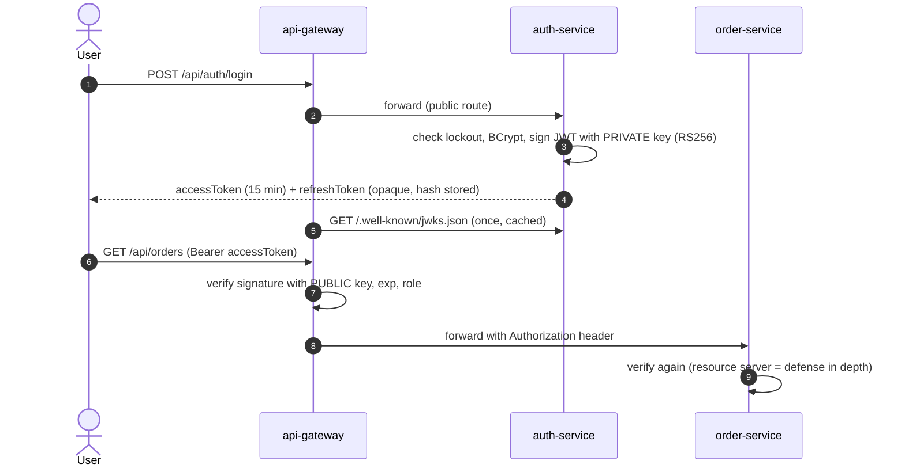

# Kiến trúc — Pameobeo

> Hệ thống đặt pate tươi cho mèo theo mô hình **đặt trước, chốt đơn 18:00, nấu rồi giao hôm sau**, tối đa 50 hộp mỗi ngày nấu.

---

## 1. Tổng quan



| Service | Port | Trách nhiệm | Database |
|---|---|---|---|
| **api-gateway** | 9000 | Cửa vào duy nhất. Định tuyến, kiểm tra JWT (401), kiểm tra quyền ADMIN (403), gắn `X-Correlation-Id` | — |
| **auth-service** | 9001 | Đăng ký, đăng nhập, cấp JWT ký RS256, công bố public key (JWKS), refresh token (idle 30 phút, tối đa 7 ngày), khóa 15 phút sau 5 lần sai | `auth_db` |
| **order-service** | 9002 | Tạo đơn, state machine của đơn, điều phối Saga, Outbox, gọi kitchen qua REST có Circuit Breaker, job chốt đơn 18:00 | `order_db` |
| **kitchen-service** | 9003 | Menu, ngày nấu, công suất 50 hộp, giữ / trả suất (tham gia Saga), endpoint chaos để demo | `kitchen_db` |
| **notification-service** | 9004 | Nghe `OrderStatusChanged`, gửi email song song trên virtual threads | `notification_db` |

---

## 2. Bounded context

| Context | Ngôn ngữ nghiệp vụ | Aggregate | Luật bất biến quan trọng |
|---|---|---|---|
| **Identity** (auth) | user, role, session, refresh token | `User`, `RefreshToken` | Email duy nhất; 5 lần sai → khóa 15 phút; session idle 30 phút, tối đa 7 ngày |
| **Ordering** (order) | đơn, món, trạng thái, hủy | `Order` (+ `OrderItem`, `Money`) | Tối đa 10 hộp/đơn; chuyển trạng thái đúng thứ tự; chỉ hủy trước giờ chốt; giá chụp lại lúc đặt |
| **Kitchen** (kitchen) | ngày nấu, công suất, suất, giờ chốt, menu | `CookingDay`, `SlotReservation`, `MenuItem` | Không bao giờ nhận quá công suất; đặt sau 18:00 thì sang ngày kế tiếp |
| **Notification** | email, người nhận | — (`NotificationPolicy`) | Mỗi event chỉ gửi email 1 lần |

Không có khóa ngoại xuyên service. `order_db.orders.customer_id` chỉ là UUID lấy từ JWT. Tên và giá món được **chụp lại** vào `order_items`, nên order-service không phải gọi kitchen khi đọc đơn cũ.

---

## 3. Clean Architecture trong từng service

```
com.pameobeo.<service>
├── domain/            Aggregate, value object, luật nghiệp vụ. Java thuần: không Spring, không JPA
├── application/
│   ├── port/in/       Use case interface (PlaceOrderUseCase, ReserveSlotUseCase, ...)
│   ├── port/out/      Interface cho thứ bên ngoài (OrderRepository, KitchenGateway, OrderEventPublisher, ...)
│   └── service/       Hiện thực use case, chỉ phụ thuộc domain + port
├── infrastructure/    Adapter: JPA, Kafka (outbox, listener), REST client + Circuit Breaker, config, security
└── interfaces/rest/   Controller, request/response DTO, xử lý lỗi
```



- **Chiều phụ thuộc luôn hướng vào trong.** `domain` không biết gì về Spring hay database.
- **JPA entity tách khỏi domain model.** Ví dụ `OrderJpaEntity` nằm ở infrastructure, có `fromDomain()` / `toDomain()`.
- **Bean được ghép ở `infrastructure/config/BeanConfig`** (composition root). Lớp application không có `@Service`, chỉ có `@Transactional`.
- **Luật được kiểm tra bằng test** `architecture/CleanArchitectureTest` (ArchUnit), chạy trong `mvn verify` của mọi service.

---

## 4. Giao tiếp giữa các service

| Tương tác | Kiểu | Vì sao |
|---|---|---|
| Client → services | REST qua gateway | Một cửa vào, kiểm tra token tập trung |
| order → kitchen: lấy ngày nấu, số suất còn lại, giá | **REST đồng bộ** + Circuit Breaker | Khách cần câu trả lời **ngay** (hết suất? qua giờ chốt? giá bao nhiêu?) để báo lỗi sớm. Đây là lời gọi cần bảo vệ bằng CB |
| order → kitchen: **giữ suất** | **Kafka** (`OrderCreated` → `SlotReserved` / `SlotFull`) | Việc giữ suất phải chắc chắn xảy ra kể cả khi kitchen tạm chết. Kafka giữ message tới khi kitchen xử lý xong (Saga, eventual consistency) |
| order → kitchen: trả suất khi hủy | Kafka (`OrderCancelled`) | Như trên |
| order → notification | Kafka (`OrderStatusChanged`) | Gửi email không được làm chậm đặt hàng |
| services → auth: lấy public key | REST (JWKS), cache | Kiểm tra JWT tại chỗ, không gọi auth mỗi request |

> 💡 **Vì sao vừa REST vừa Kafka giữa order và kitchen?** REST chỉ dùng để **hỏi** (không thay đổi gì), nên có thể trả lời nhanh và báo lỗi sớm. Việc **giữ suất** (thay đổi dữ liệu) đi qua Kafka, nên không mất khi kitchen chết, và được tuần tự hóa an toàn bằng optimistic locking ở kitchen. Số suất mà REST trả về chỉ để tham khảo. Quyết định cuối cùng nằm ở kitchen khi xử lý `OrderCreated`.

---

## 5. Các luồng chính

### 5.1. Đặt hàng thành công (UC02)



### 5.2. Saga bù trừ: hết suất (UC02 - Ex3)



Nếu A và B tới kitchen **cùng lúc** trên 2 partition khác nhau, cả hai cùng đọc `version = 7`. Transaction nào commit sau sẽ bị `OptimisticLockException`, rollback toàn bộ (kể cả bản ghi `processed_events`). Kafka giao lại message, lần thử lại đọc dữ liệu mới và thấy đã hết suất. Database còn có thêm ràng buộc `CHECK (reserved_count <= capacity)` làm lưới an toàn cuối cùng.

### 5.3. Kitchen chậm: Circuit Breaker (UC02 - Ex5)



### 5.4. Hủy đơn (UC03)



---

## 6. Độ tin cậy của messaging

| Vấn đề | Giải pháp | Ở đâu trong code |
|---|---|---|
| Lưu DB xong nhưng gửi Kafka lỗi → mất event | **Transactional Outbox**: ghi event vào `outbox_events` trong cùng transaction | `infrastructure/messaging/OutboxWriter` (`Propagation.MANDATORY`) |
| Đẩy outbox lên Kafka | **Polling Publisher** mỗi 300 ms, `FOR UPDATE SKIP LOCKED` | `OutboxRelay` |
| Kafka giao lại message (at-least-once) | **Idempotent Consumer**: `INSERT ... ON CONFLICT DO NOTHING` vào `processed_events` trong cùng transaction | `JdbcProcessedEventStore` |
| Hai consumer cùng sửa một ngày nấu | **Optimistic locking** `@Version` + retry của Kafka | `CookingDayJpaEntity`, `KafkaConfig` |
| Message lỗi mãi (poison message) | Retry có backoff rồi đẩy sang **Dead Letter Topic** `<topic>.DLT` | `KafkaConfig.kafkaErrorHandler` |
| Thứ tự event của một đơn | Kafka **key = orderId**: mọi event của một đơn nằm trên cùng partition | `OutboxOrderEventPublisher` |

---

## 7. Bảo mật



- **RS256 thay vì HS256:** chỉ auth-service giữ private key. Các service khác chỉ có public key nên không thể tự tạo token giả.
- **Kiểm tra 2 lớp:** gateway chặn sớm (401/403), service kiểm tra lại. Nếu ai đó gọi thẳng vào service, bỏ qua gateway, request vẫn bị chặn.
- **Truyền token giữa các service:** order-service chuyển tiếp JWT của người dùng khi gọi kitchen (`KitchenClientConfig`), nên kitchen biết ai đang hỏi.
- **Refresh token** là chuỗi ngẫu nhiên, DB chỉ lưu SHA-256. Mỗi lần refresh thì token cũ bị thu hồi (rotation). Nếu một token cũ bị dùng lại, mọi session của user bị thu hồi (phát hiện token bị đánh cắp).

---

## 8. Database (tóm tắt)

| Database | Bảng |
|---|---|
| `auth_db` | `users` (failed_login_attempts, locked_until), `refresh_tokens` (token_hash, idle_expires_at, absolute_expires_at, revoked) |
| `kitchen_db` | `menu_items`, `cooking_days` (capacity, reserved_count, **version**, CHECK reserved ≤ capacity), `slot_reservations`, `outbox_events`, `processed_events` |
| `order_db` | `orders` (status, cutoff_at, **version**, UNIQUE (customer_id, idempotency_key)), `order_items` (snapshot giá), `outbox_events`, `processed_events` |
| `notification_db` | `notification_logs` (thread), `processed_events` |

Schema được quản lý bằng **Flyway** (`src/main/resources/db/migration/V1__init.sql` trong mỗi service), Hibernate chỉ `validate`.
